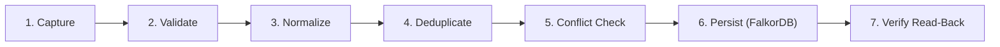
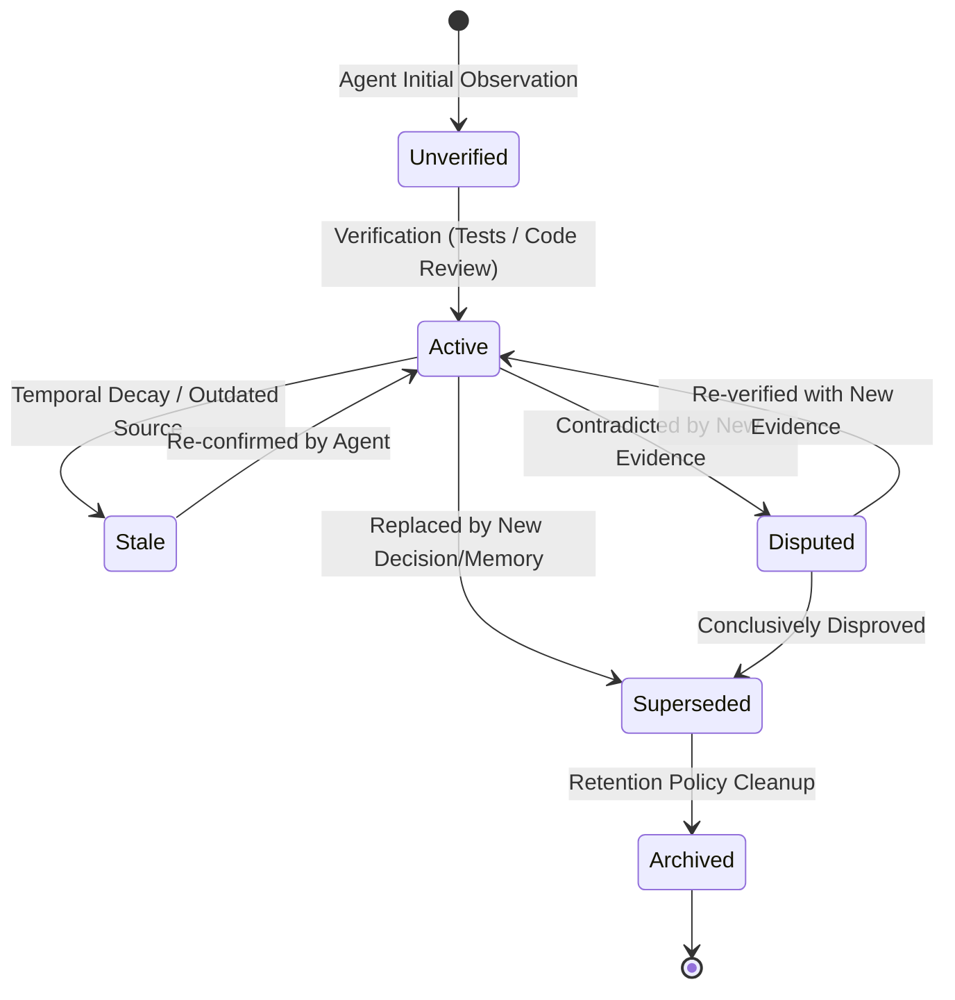

# Memory Lifecycle & State Machine

## 1. Lifecycle Pipeline

The memory system implements a strict pipeline to guarantee data integrity, avoid duplicate knowledge bloat, prevent concurrent overwrite bugs, and track epistemic validity:



### Step 1: Capture
Raw observation, finding, or decision received from an agent via MCP or Python API.

### Step 2: Validate
Pydantic schemas validate required fields:
- Mandatory `workspace_id`, non-empty `content`.
- Bounded confidence (0.0 to 1.0).
- Permitted enum values for `memory_type`, `status`, `source_type`.

### Step 3: Normalize
- Text content is trimmed and normalized.
- Stable deterministic hashing (`SHA-256`) is computed over normalized text + workspace to generate content signatures.
- Timestamps are standardized in UTC ISO-8601 (`YYYY-MM-DDTHH:MM:SSZ`).

### Step 4: Deduplicate
- Query the graph for existing memories in the workspace with identical content hash or key attributes.
- If an exact duplicate exists:
  - If identical: update timestamp and reinforce confidence without inserting a redundant node.
  - If minor revision: branch into update or supersession.

### Step 5: Conflict Resolution
- Detect if the new claim contradicts an existing memory or supersedes an older version.
- If explicit `superseded_by` or `supersedes` is provided:
  - Transition the older memory status to `superseded`.
  - Create a `:SUPERSEDES` graph relationship from the new memory to the older one.

### Step 6: Persist
- Execute parameterized openCypher statements (`MERGE` or `CREATE`).
- Optimistic version checks verify that `target.version == expected_version`.
- Increment `version` to guard against race conditions.

### Step 7: Verify
- Immediately query back the persisted node ID to verify that write succeeded.
- Return structured memory record with assigned IDs and version counters.

---

## 2. Memory State Machine



### State Definitions
- `unverified`: Initial observation recorded by an agent without programmatic verification or supporting evidence.
- `active`: Verified, high-confidence memory actively considered in search ranking.
- `stale`: Information that has exceeded its validity period, or relates to files modified since the memory was captured.
- `disputed`: Conflicting findings reported by different agents or developers.
- `superseded`: Deprecated claim explicitly replaced by a newer decision or observation.
- `archived`: Preserved for audit/provenance but excluded from default context retrieval packets.

---

## 3. Optimistic Concurrency Control

To prevent silent lost updates when multiple agents collaborate:
1. Every `Memory` and `Decision` node maintains an integer `version` field (starts at 1).
2. Any update tool call (`memory_update`) requires the client to supply the known `version`.
3. The update Cypher query atomically checks:
   ```cypher
   MATCH (m:Memory {id: $id, workspace_id: $workspace_id})
   WHERE m.version = $expected_version
   SET m.content = $new_content,
       m.version = m.version + 1,
       m.updated_at = $timestamp
   RETURN m
   ```
4. If no rows are modified, a `ConcurrentModificationError` (HTTP 409 equivalent) is raised, alerting the agent to re-fetch the latest state before retrying.

Session checkpoint and close operations use the same atomic version comparison, so concurrent agents cannot silently overwrite handoff state. Conversation messages use caller-supplied message IDs as idempotency keys when retry safety is needed; transcript reads are workspace-scoped and bounded.
